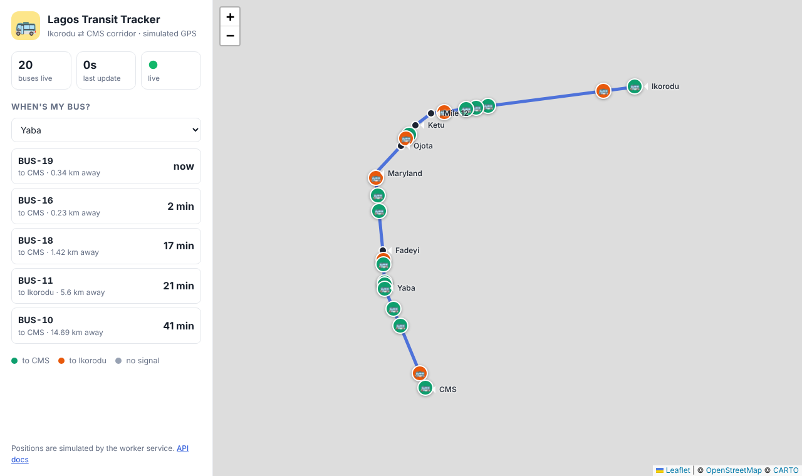

# Lagos Transit Tracker 🚌

A fleet of simulated buses drives the **Ikorodu → CMS** corridor. An API tells you which buses are coming to your stop, and roughly when.

> Uses **simulated GPS**. A production version would ingest driver-phone or BRT tracking feeds.



## How it works
```
worker (fake GPS) ──every 5s──▶ Redis ◀── api (FastAPI) ◀── web (nginx: map page + /api proxy) ◀── you
   :9100/metrics                hash  bus:<id>       :8000            :8080
                                stream positions
```
| Service | What it does | Port |
|---|---|---|
| `worker/` | Simulates `NUM_BUSES` buses. Every tick, each bus moves (Lagos traffic included 😅), and its position is written to Redis | 9100 (metrics) |
| `api/` | Reads positions from Redis and serves the endpoints below | 8000 |
| `web/` | A live map (Leaflet): buses glide along the route every 3s, plus a "when's my bus?" panel. nginx serves it and forwards `/api/*` to the api | 8080 |
| Redis | Shared state between the worker and the api | 6379 |

## API
| Endpoint | Returns |
|---|---|
| `GET /health` | `{"status":"ok"}`, or **503** if Redis is unreachable |
| `GET /stops` | The 8 stops with coordinates |
| `GET /buses` | Every bus: position, speed, next stop, `age_seconds`, `stale` |
| `GET /eta/{stop}` | The next 5 buses coming to that stop, e.g. `/eta/yaba` |
| `GET /metrics` | Prometheus metrics |
| `GET /docs` | Swagger UI to try it all in a browser |

## Configuration (environment variables)
| Variable | Default | Used by |
|---|---|---|
| `REDIS_URL` | `redis://localhost:6379/0` | both |
| `NUM_BUSES` | `20` | worker |
| `TICK_SECONDS` | `5` | worker |
| `METRICS_PORT` | `9100` | worker |
| `STALE_AFTER_SECONDS` | `30` | api: positions older than this are ignored for ETAs |
| `CORS_ORIGINS` | `*` | api: which web pages may call it from another address (not needed behind the nginx proxy) |

## Metrics (for later blocks)
| Metric | Service | Meaning |
|---|---|---|
| `transit_positions_published_total` | worker | GPS updates sent |
| `transit_publish_errors_total` | worker | Updates that failed (is Redis down?) |
| `http_requests_total{path,status}` | api | Traffic and errors |
| `http_request_duration_seconds` | api | Latency |
| `transit_newest_position_age_seconds` | api | **Data freshness.** If this climbs, the worker has stopped |

## Run without Docker (to see it work first)
Requires Python 3.11+ and a Redis server running locally.
```bash
# terminal 1
cd worker && pip install -r requirements.txt && python worker.py
# terminal 2
cd api && pip install -r requirements.txt && uvicorn app.main:app --port 8000
```
Open http://localhost:8000/docs

To see the map without nginx, serve `web/` with any static server and point it at the API:
```bash
cd web && python -m http.server 8081
# open http://localhost:8081/?api=http://localhost:8000
```

## Tests
```bash
cd api && pip install -r requirements-dev.txt && pytest -q
cd worker && pip install -r requirements-dev.txt && pytest -q
```
They use `fakeredis`, so no real Redis is needed. These run in CI later.

---

## 🛠️ Your DevOps tasks (Block by Block)
- [ ] **Block 1, Docker:** write `api/Dockerfile`, `worker/Dockerfile` and `web/Dockerfile` (nginx serving the static files with `web/nginx.conf`, running non-root on 8080)
- [ ] **Block 2, Compose:** `docker-compose.yml` running redis, worker, api and web together, with healthchecks and `depends_on`. The web container reaches the API at `http://api:8000`, so the compose service **must** be called `api`
- [ ] **Block 3, Infra:** a Kubernetes cluster (kind locally, or EKS with Terraform)
- [ ] **Block 4, CI:** run the tests, build, scan with Trivy, and push to GHCR on every push
- [ ] **Block 5, CD:** deploy from CI with no stored keys
- [ ] **Block 6, Helm:** your own chart, then a bad release and rollback
- [ ] **Block 7, Metrics:** Prometheus scraping both services
- [ ] **Block 8, SLOs:** for example "99% of `/eta` requests succeed" and "positions are less than 30s old"
- [ ] **Block 9, Dashboard and logs:** Grafana, Loki
- [ ] **Block 10, Incident:** kill the worker, catch it with an alert, then write the postmortem
